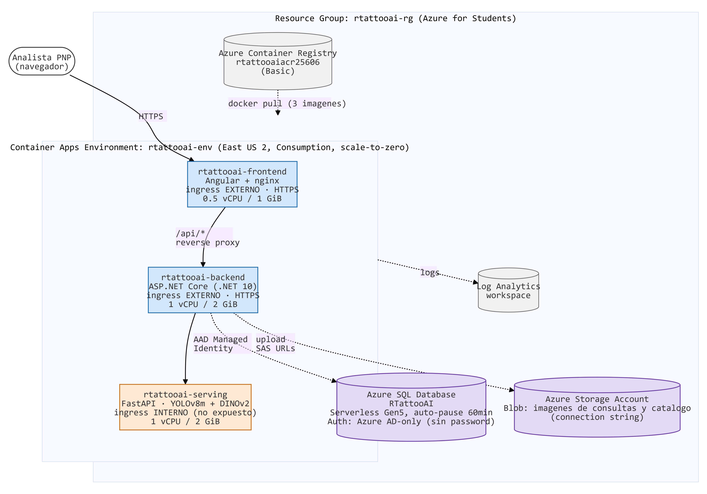

# RTattooAI — Backend

API en ASP.NET Core (.NET 10) del proyecto **RTattooAI**: orquesta el análisis
de tatuajes para apoyar a la Policía Nacional del Perú (PNP) en la
identificación preliminar de tatuajes asociados a bandas organizadas.

> Es una herramienta de apoyo al análisis preliminar, no un sistema de
> identificación definitiva. Todo resultado debe interpretarse como una
> sugerencia que requiere validación humana (campo `disclaimer` en cada
> respuesta).

Este repositorio es uno de los tres que componen el sistema completo. Ver
[Repositorios relacionados](#repositorios-relacionados).

## Qué hace

El backend no corre ningún modelo de IA. Es el orquestador: recibe la imagen
del analista, la guarda en Azure Blob Storage, la envía al microservicio de
inferencia (`rtattooai-ml/serving`), persiste el resultado (detecciones,
coincidencias contra el catálogo de bandas y el `verdict` de cada una) y lo
expone al frontend.

Funcionalidad implementada:

- **Autenticación** con JWT y roles (`analyst`, `supervisor`, `admin`),
  aplicados con `[Authorize(Roles=...)]` en el servidor (no solo en el cliente).
- **Análisis de imágenes**: subida, llamada al servicio de IA, persistencia de
  detecciones/coincidencias, generación de miniatura para el historial.
- **Historial de consultas** con filtros y detalle por análisis.
- **Catálogo de tatuajes de bandas**: alta desde detecciones validadas,
  asignación de banda, miniaturas.
- **Validación pericial** por detección (confirmar, marcar para revisión,
  descartar) — el criterio final siempre lo da una persona.
- **Gestión de usuarios** (CRUD básico + roles) para administradores.
- **Panel de métricas** (`/api/dashboard/metrics`): volumen de análisis,
  estado de validaciones, catálogo, usuarios, tendencia de 30 días y bandas
  más identificadas.
- **Keep-warm**: `GET /health/deep` hace ping también al servicio de IA
  interno para mitigar el cold start de Azure Container Apps (ver
  [`.github/workflows/keep-warm.yml`](.github/workflows/keep-warm.yml)).

## Arquitectura

Capas clásicas, de afuera hacia adentro:

```
src/
├── RTattooAI.Api/             Controllers, Program.cs, JWT, CORS, DI
├── RTattooAI.Application/     Servicios, DTOs, interfaces (Abstractions/)
├── RTattooAI.Domain/          Entidades: Usuario, Consulta, Deteccion,
│                               Coincidencia, TatuajeCatalogo, BandaCriminal
└── RTattooAI.Infrastructure/  EF Core (SQL Server), Blob Storage,
                                HttpClient tipado hacia el servicio de IA
```

Reglas: los controllers son delgados (la lógica vive en `Application`); hacia
afuera solo se exponen DTOs, nunca entidades; todo I/O es `async`; no hay
secretos en el código (connection strings, JWT secret, URL del servicio de IA
y credenciales de Blob salen de variables de entorno / `appsettings`).

### Despliegue

Desplegado en Azure Container Apps (Consumption, `min-replicas=0`) junto al
frontend y al servicio de IA. Diagrama completo:



## Repositorios relacionados

| Repo | Contenido |
|------|-----------|
| [`rtattooai-frontend`](https://github.com/RTattooAI/rtattooai-frontend) | Cliente Angular usado por los analistas |
| [`rtattooai-ml`](https://github.com/RTattooAI/rtattooai-ml) | Entrenamiento de los modelos (YOLOv8 + DINOv2) y el microservicio FastAPI de inferencia (`serving/`) que este backend consume |

El contrato de API que conecta los tres repos está documentado en
[`RTattooAI_API_CONTRACT.md`](RTattooAI_API_CONTRACT.md) (espejado también en
los otros dos repos para que se mantenga sincronizado).

## Cómo correrlo en local

Requisitos: .NET 10 SDK, SQL Server (local o contenedor) o Azure SQL, y el
microservicio de IA corriendo (ver `rtattooai-ml/serving`).

```powershell
# Configurar conexión a SQL, JWT secret, Blob y URL del servicio de IA
copy .env.example .env   # completar valores, nunca commitear con datos reales

dotnet restore
dotnet build

# Migraciones de base de datos
dotnet ef database update --project src/RTattooAI.Infrastructure --startup-project src/RTattooAI.Api

dotnet run --project src/RTattooAI.Api
```

También hay un `docker-compose.local.yml` para levantar SQL Server en
contenedor sin instalarlo localmente.

### Pruebas

```powershell
dotnet test tests/RTattooAI.Application.Tests
```

## Documentación adicional

- [`CLAUDE.md`](CLAUDE.md) — contexto, convenciones y reglas de trabajo para
  desarrollar sobre este repo.
- [`RTattooAI_API_CONTRACT.md`](RTattooAI_API_CONTRACT.md) — contrato de API
  congelado entre frontend, backend y servicio de IA.
- [`RTattooAI_BACKLOG_y_FLUJO.md`](RTattooAI_BACKLOG_y_FLUJO.md) — historias
  de usuario y flujo funcional.

## Convenciones de trabajo

- Solo ramas `feature/*` o `fix/*`; nunca commits directos a `main`.
- Sin secretos en el repo bajo ninguna circunstancia.
